# Actividad3: Exploración de componentes de VS Code
                     Wilches García Mayra Alejandra
                        Universidad de la Sabana
                          15 de octubre de 2026

## 1. Componentes de VS Code 

### 1.1 Editor de código

Es la zona del centro donde escribo el código. Aquí escribí el programa main.py, que hace una suma.

### 1.2 Explorador de archivos 
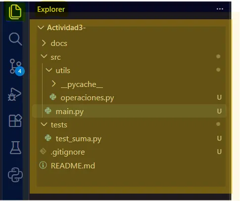 

Está a la izquierda y muestra las carpetas y archivos del proyecto. Desde ahí creo, abro y organizo todo. 

### 1.3 Terminal integrada
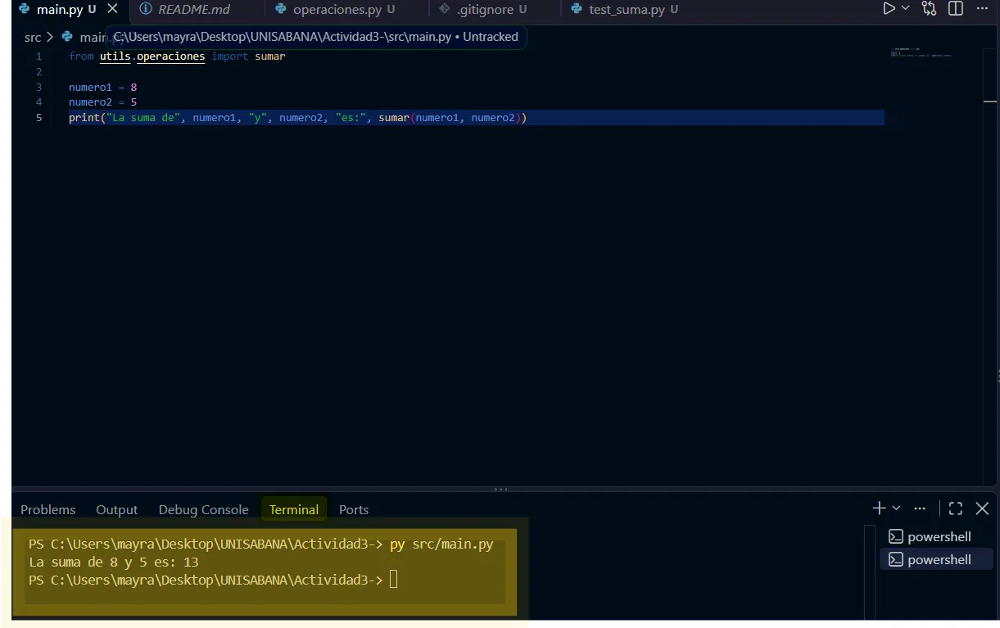 
Está en la parte de abajo. Sirve para escribir comandos sin salir de VS Code. La usé para correr el programa con `py src/main.py`.

### 1.4 Barra de estado 
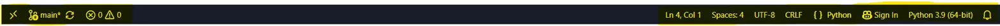 
Es la franja de abajo del todo. Me muestra la rama de Git (`main`), si hay errores o advertencias, la línea donde estoy, la codificación, el lenguaje (Python) y la versión de Python (3.9).

### 1.5 Menú File 
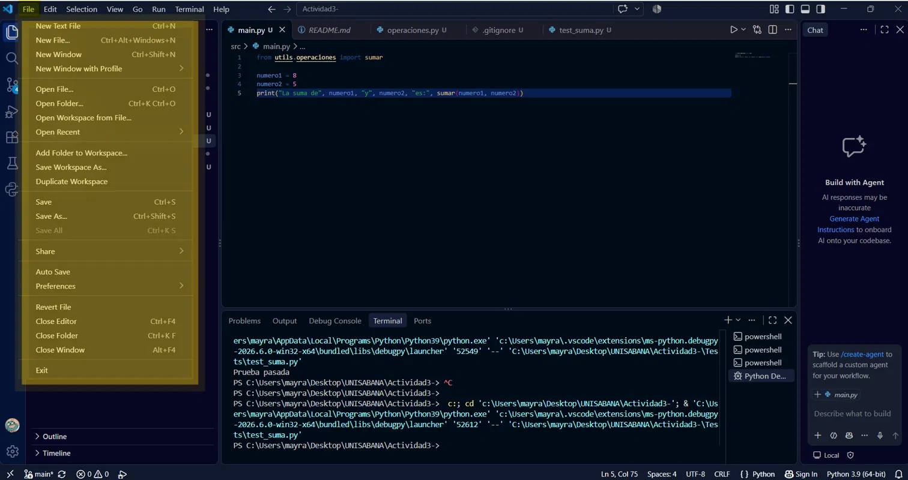 
Sirve para crear, abrir y guardar archivos y carpetas. También tiene opciones como Save, Open Folder y Auto Save.

### 1.6 Menú Edit 
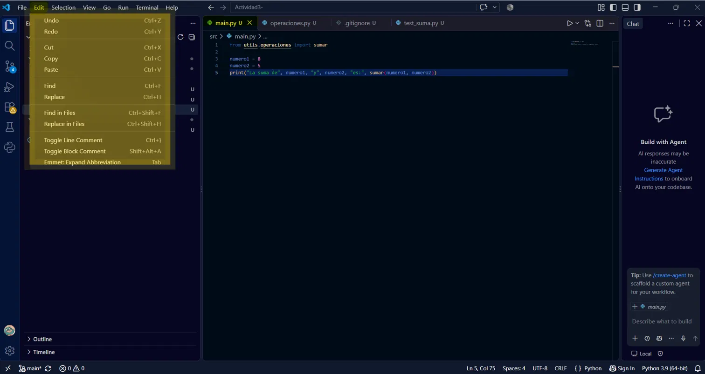 
Tiene las opciones de deshacer, rehacer, cortar, copiar, pegar y buscar o reemplazar texto. 

### 1.7 Menú Selection
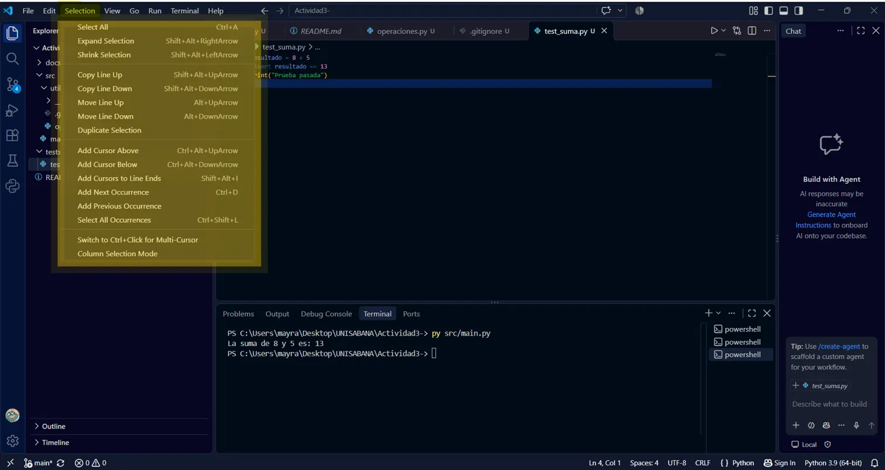 
Sirve para seleccionar texto y para mover, copiar o duplicar líneas de código. 

### 1.8 Menú View
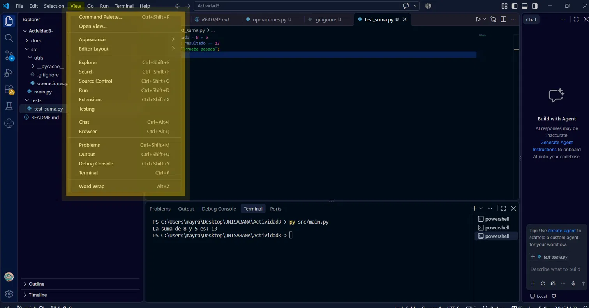 
Controla qué paneles se ven, como el Explorer, la Terminal o las Extensions. También tiene la Command Palette.

### 1.9 Menú Go
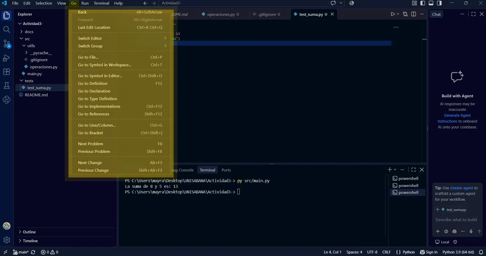 
Sirve para moverse rápido entre archivos, ir a una línea o a una función, y volver al lugar donde estaba antes.

### 1.10 Menú Run
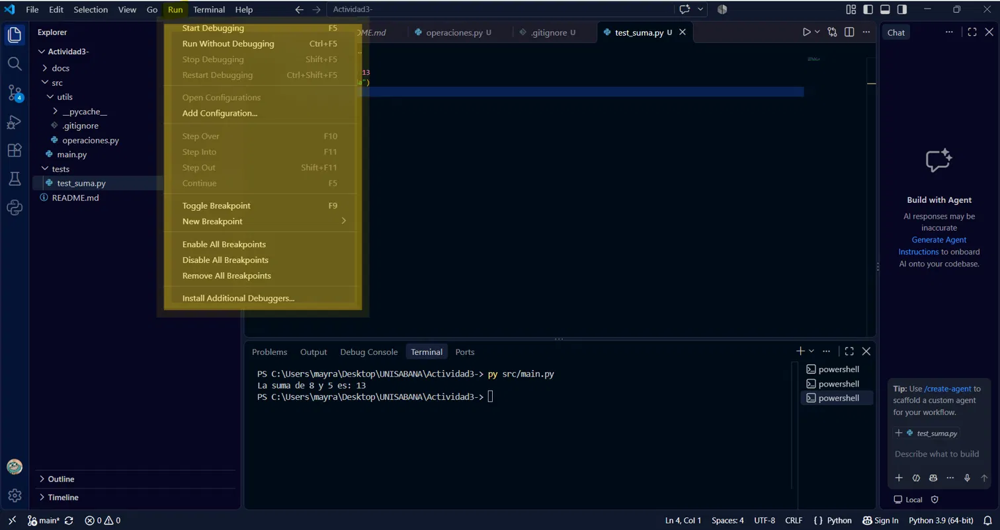 
Se usa para ejecutar el programa y para depurarlo, por ejemplo con breakpoints.

### 1.11 Menú Help
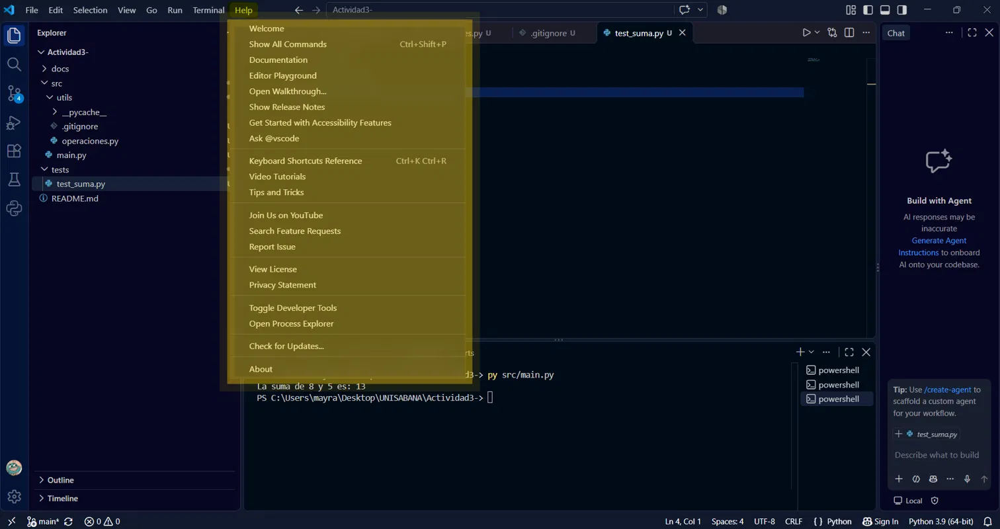 
Tiene la documentación, los atajos de teclado, los tutoriales y la opción de buscar actualizaciones.

## 1.12 Run and Debug
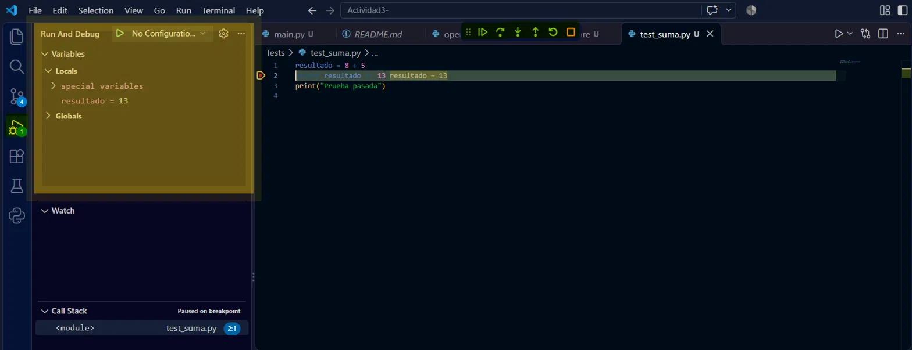 
Es el panel del depurador. Puse un breakpoint en la línea 2 de `test_suma.py` y el programa se pausó ahí. Así pude ver que la variable `resultado` valía 13.

### 1.13 Extensiones
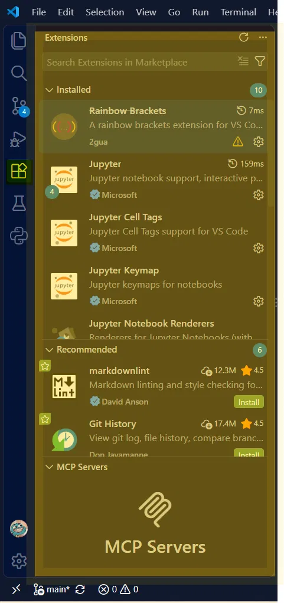 
Es donde se instalan herramientas extra para VS Code. Yo tengo instaladas las de Python y Jupyter, entre otras.

### 1.14 Source Control
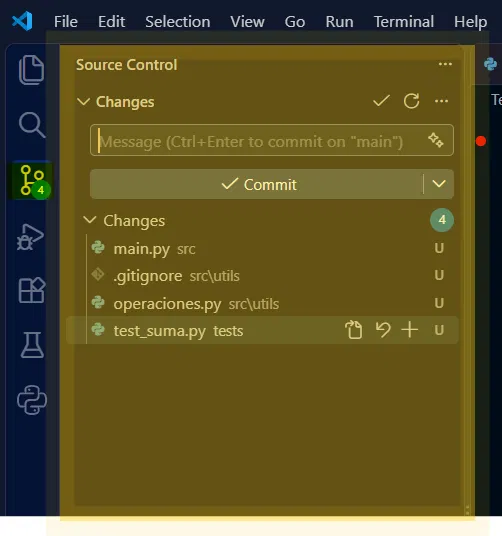 
Es la parte de Git. Muestra los archivos que he cambiado (con la letra U porque todavía no los subía) y desde ahí se pueden hacer los commits.

## 2. Personalización de la interfaz

### 2.1 Tema
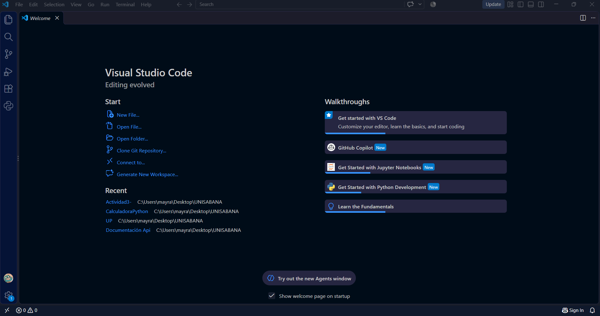 
Cambié el tema de negro a azul rey. Lo hice en "File" - "Preference" - "Themes" - "Color theme".

### 2.2 Tamaño de la letra
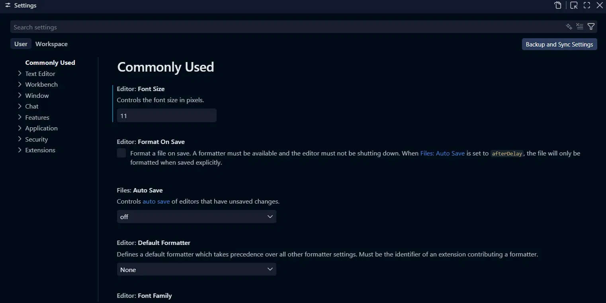 
El tamaño de la letra estaba en 14 y lo cambié a 11. Lo hice en "File" - "Preference" - Settings" - "Font size". 

### 2.3 Atajo de teclado
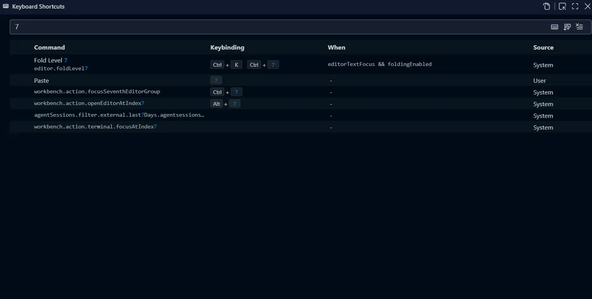
Entré a Keyboard Shortcuts con `Ctrl + K Ctrl + S` y le puse al comando Paste la tecla 7 para probar cómo se personalizan los atajos. 

### 2.4 Extensiones
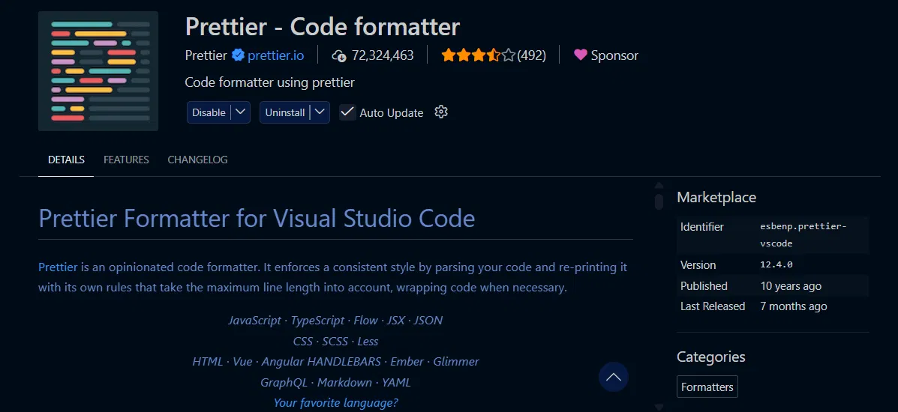 
Instalé Prettier. Sirve para acomodar el código automáticamente con un mismo estilo, y así se ve más ordenado.

### 2.5 Disposición de paneles
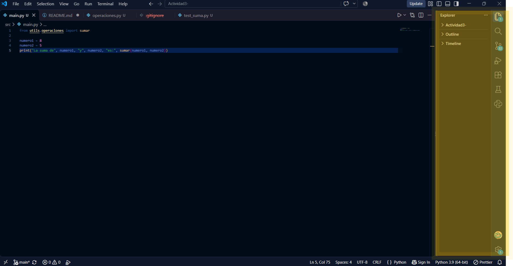 
Moví la terminal hacia la derecha desde el menú "View" - "Appearance" - "Move primary side bar rigth".

## 3. Conclusión
En esta actividad exploré los componentes principales de Visual Studio Code, como el editor, el explorador, la terminal, los menús, el depurador, las extensiones y el control de código fuente, y documenté cada uno con capturas y una explicación. También personalicé la interfaz cambiando el tema, el tamaño de la letra, los atajos, las extensiones y la disposición de los paneles. Por último, creé un proyecto en Python con una estructura organizada (`src`, `utils`, `docs` y `tests`), un programa que realiza una suma, una prueba, un entorno virtual y control de versiones con Git, y lo subí a GitHub.

